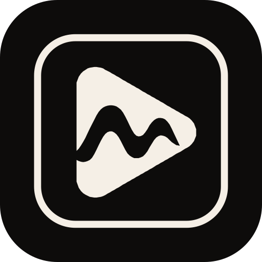
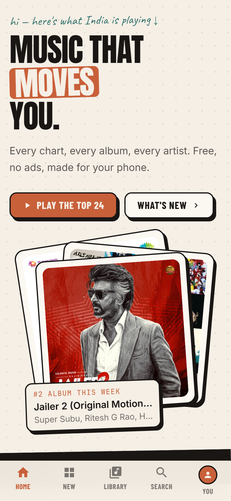
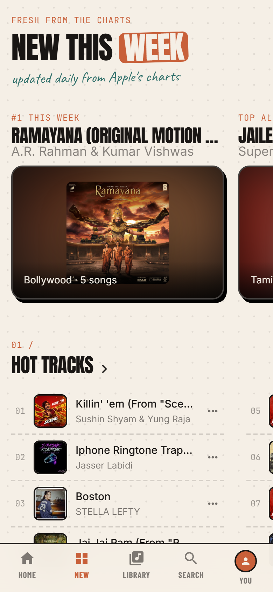
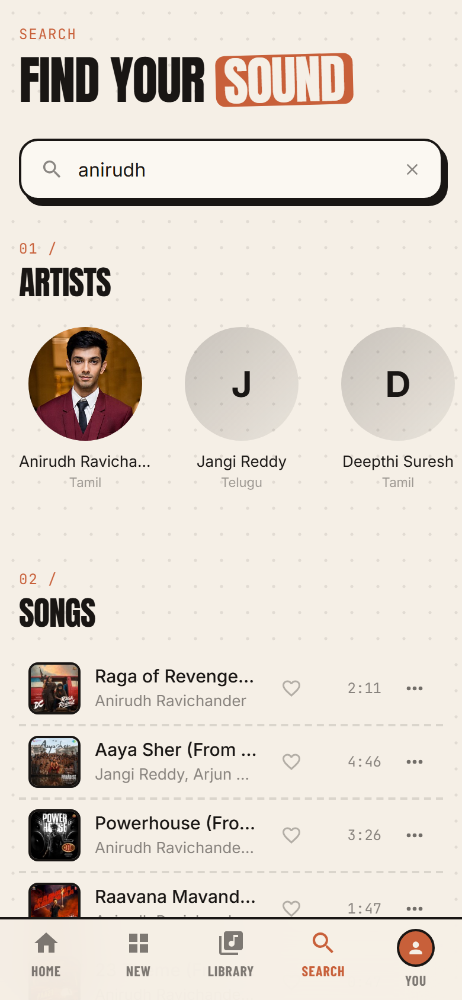
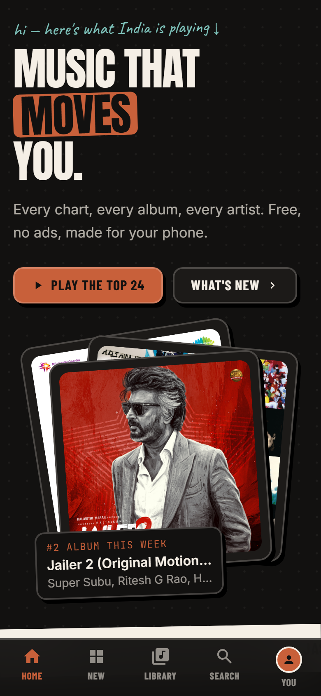
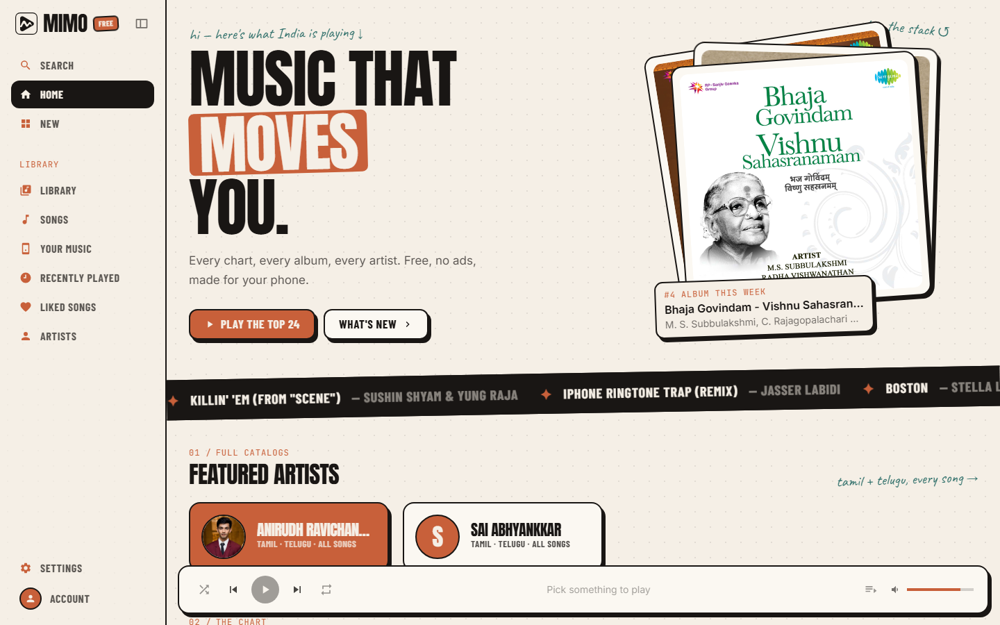
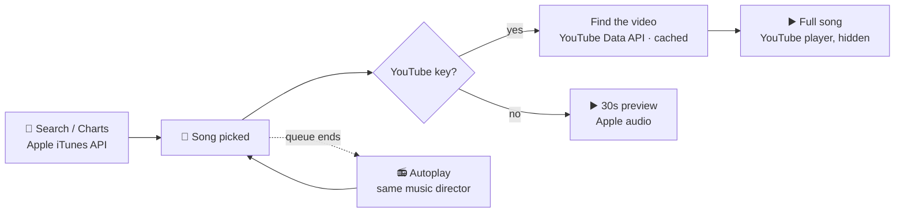

<div align="center">



# Mimo

**Music, everywhere.** A personal music player with the polish of Apple Music and Spotify.
<br/>Every chart, every album, every artist. Free, no ads, no accounts. Runs in the browser and as an Android app.

<br/>


[**Features**](#-features) · [**Screenshots**](#-screenshots) · [**Quick start**](#-quick-start) · [**Android app**](#-android-app) · [**How it works**](#-how-it-works) · [**Project map**](#-project-map)

</div>

<br/>

## 📸 Screenshots

<div align="center">

| Home | New this week | Search | Dark theme |
|:---:|:---:|:---:|:---:|
|  |  |  |  |



</div>

<br/>

## ✨ Features

<table>
<tr>
<td width="50%" valign="top">

### 🎧 Listen
- **Full songs** through YouTube, with your own free API key
- **30-second previews** without a key, so it works from minute one
- **Now Playing:** cover art first, swipe to the video; colours tinted from the artwork
- **Synced lyrics** with fallbacks, so most songs have them
- **Autoplay:** when the queue ends it keeps going with more by the **same music director**
- **Sleep timer**, shuffle, repeat, and a queue you can swipe and drag

</td>
<td width="50%" valign="top">

### 📚 Collect
- **Library** in a Spotify-style grid: playlists, albums, artists
- **Long-press / right-click menu:** play, edit, pin to top, delete, remove
- **Playlists** with your own cover photo and description
- **Liked Songs**, **Recently Played**, and **Your Music** (your own audio files, fully offline)
- **Made for You:** Daily Mixes from your top artists
- **Backup & restore** to a file (your API key is never included)

</td>
</tr>
<tr>
<td width="50%" valign="top">

### 🌏 Discover
- Apple's charts and catalogue for **India and other countries**
- Hot tracks, top albums, new this week, genre shelves
- Artist pages with photos, bios, and full discographies
- Monthly listening stats on your Account page

</td>
<td width="50%" valign="top">

### 🎨 Feel
- Cream **Editorial** and **Dark** themes, plus accent colours
- Animated launch screen, page slides, press feedback, haptics
- The mini player and tab bar stay fixed while pages slide
- Built phone-first; a sidebar layout on desktop

</td>
</tr>
</table>

> Everything is saved **on your device**. There are no accounts and no server, and nothing is tracked.

<br/>

## 🚀 Quick start

```bash
git clone https://github.com/Vamsee295/mimo-music.git
cd mimo-music
npm install
npm run dev          # → http://localhost:3000
```

**Unlock full songs (5 minutes, free):** open **Settings → Full songs (YouTube)** and paste a YouTube Data API v3 key.

<details>
<summary><b>🔑 How to get a YouTube API key</b></summary>
<br/>

1. Create a project at **[Google Cloud Console](https://console.cloud.google.com/projectcreate)** (free, no card)
2. Enable **[YouTube Data API v3](https://console.cloud.google.com/apis/library/youtube.googleapis.com)**
3. **[Credentials](https://console.cloud.google.com/apis/credentials)** → *Create credentials* → *API key*
4. *(Recommended)* Restrict the key to **YouTube Data API v3** only
5. In Mimo: **Settings → Full songs (YouTube)** → paste → **Test** → **Save settings**

A key starts with `AIza` and is 39 characters long. Each key covers about **99 new songs a day**. Songs you've played before are remembered and cost nothing.

📄 **The illustrated guide:** [`docs/Mimo-YouTube-Setup.pdf`](docs/Mimo-YouTube-Setup.pdf)

</details>

<br/>

## 📱 Android app

```bash
npm run apk          # → android/app/build/outputs/apk/debug/app-debug.apk
```

Copy `app-debug.apk` to your phone and open it. Allow "install unknown apps" if Android asks.

<details>
<summary><b>🛠️ What the build needs and does</b></summary>
<br/>

**Needs:** JDK 21 and the Android SDK. Set the SDK path in `android/local.properties`, using forward slashes:

```properties
sdk.dir=C:/Users/<you>/AppData/Local/Android/Sdk
```

**Does:** exports the site as static files (`MIMO_EXPORT=1` → `out/`), copies them into the Android project (`cap sync`), and runs Gradle.

| Command | Result |
|---|---|
| `npm run apk` | Full build → installable APK |
| `npm run build:app` | Export + sync only (no Gradle) |
| `npx cap open android` | Opens the project in Android Studio |

</details>

<details>
<summary><b>📲 What the Android app adds</b></summary>
<br/>

- **Plays with the screen off:** a media foreground service plus wake and Wi-Fi locks
- **"Now playing" notification and lock screen** with album art, a **draggable seek bar**, and ⏮ ⏯ ⏭
- **Back button** closes menus and Now Playing first, and minimises the app on Home
- **Status bar** follows the theme, and **backups** open the Android share sheet

Native code: [`android/app/src/main/java/com/mimo/music/`](android/app/src/main/java/com/mimo/music/)

</details>

<br/>

## 🧠 How it works



| Piece | Source |
|---|---|
| Catalogue, charts, artwork | Apple's public iTunes Search & RSS feeds |
| Full-length audio | YouTube IFrame player (your own API key) |
| Lyrics | LRCLIB, synced where available |
| Your Music | Your own files, stored in IndexedDB |
| Library, settings, history | `localStorage` (zustand, persisted) |

<br/>

## 🗺️ Project map

<details>
<summary><b>Where things live</b></summary>
<br/>

| Path | What |
|---|---|
| `app/` | Pages: Home, New, Search, Library, Album, Artist, Playlist, Liked, Account, Settings |
| `components/PlayerBar.tsx` | Player engine (YouTube + local audio), mini player, Now Playing, queue, lyrics |
| `components/LibraryGrid.tsx` | Library grid with the long-press / right-click menu |
| `components/Splash.tsx` | Animated launch screen (CSS in `app/globals.css`) |
| `lib/api.ts` | iTunes catalogue · `lib/youtube.ts` video matching and key checks |
| `lib/radio.ts` | Autoplay built around the music director |
| `lib/library.ts` · `lib/store.ts` | Saved library and settings · player queue |
| `lib/local.ts` · `lib/backup.ts` | Your Music (IndexedDB) · backup format and validation |
| `lib/native.ts` | Android bridge: back button, status bar, notification, sharing |
| `docs/` | Audits, the YouTube setup PDF (`node docs/guide/build.mjs` rebuilds it), screenshots |

</details>

<details>
<summary><b>✅ Checks</b></summary>
<br/>

```bash
npx tsc --noEmit && npx eslint .
for f in lib/*.check.ts; do npx tsx "$f"; done
```

The self-checks cover YouTube matching, the player store, Your Music, backups, autoplay, artwork colours, lyrics and recents.

</details>

<br/>

## ⚠️ Note

Mimo is a **personal project**. The Android app hides the YouTube player and keeps it playing in the background. That's fine for your own phone, but it goes against YouTube's API terms, so this app isn't meant for the Play Store. Music belongs to its artists and labels. Mimo hosts no audio.

<div align="center">
<br/>

<br/>
<sub>Made with ♥ in India · <b>Mimo</b>, music everywhere.</sub>
</div>
